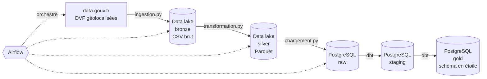
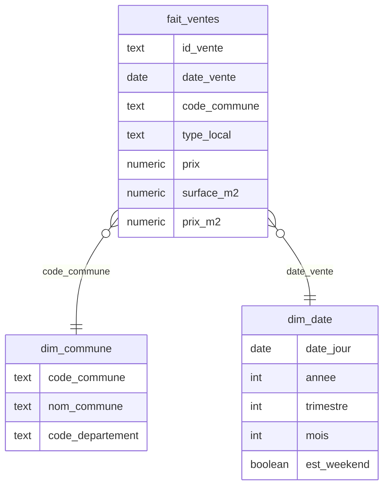
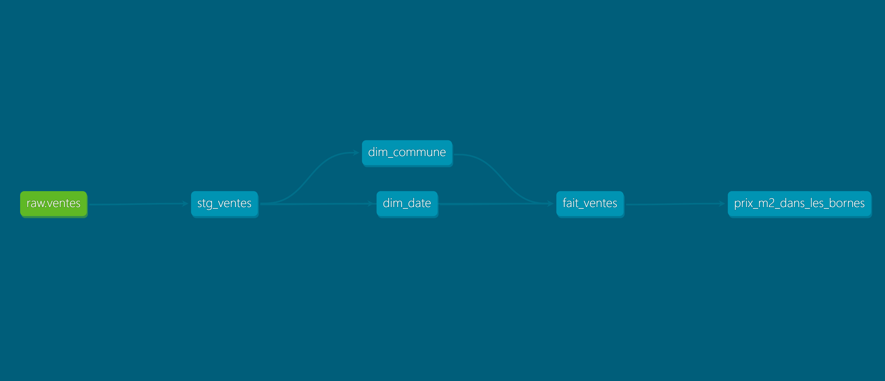
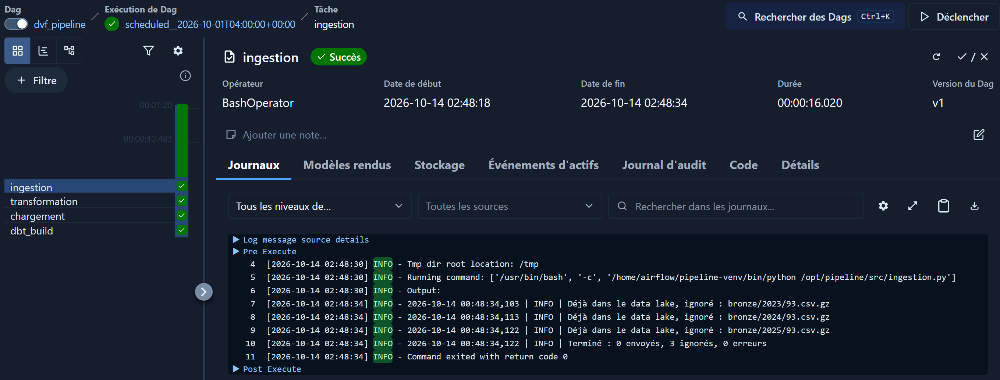

# Pipeline de données immobilières DVF


Pipeline ELT de bout en bout sur les **Demandes de Valeurs Foncières** (DVF), les ventes immobilières publiées par l'État sur data.gouv.fr.

Les données sont ingérées dans un data lake compatible S3, nettoyées en Parquet, chargées dans PostgreSQL, puis modélisées en schéma en étoile avec dbt. Le tout est orchestré par Airflow et tourne dans Docker.

---

## Architecture



| Couche | Où | Format | Contenu |
|---|---|---|---|
| Bronze | Data lake | CSV compressé | Copie exacte de la source |
| Silver | Data lake | Parquet | Ventes nettoyées, prix au m² calculé |
| Raw | PostgreSQL | Table | Silver chargé tel quel, avec traçabilité |
| Staging | PostgreSQL | Vue dbt | Colonnes renommées et typées |
| Gold | PostgreSQL | Tables dbt | Schéma en étoile |

---

## Stack technique

| Rôle | Outil |
|---|---|
| Langage | Python 3.12, SQL |
| Ingestion | Requests |
| Data lake | Silo (compatible S3), boto3 |
| Transformation | Pandas, PyArrow, Parquet |
| Data warehouse | PostgreSQL 16, SQLAlchemy |
| Modélisation | dbt |
| Orchestration | Apache Airflow 3 |
| Conteneurs | Docker, Docker Compose |
| Qualité | pytest, Ruff, tests dbt |
| CI | GitHub Actions |

---

## Modèle de données gold



- **Granularité** : une ligne de `fait_ventes` = une vente d'un logement unique
- **16 tests dbt** : unicité, non-nullité, intégrité entre faits et dimensions, valeurs autorisées, bornes du prix au m²



---

## Orchestration

Un DAG Airflow enchaîne les 4 étapes, chaque 1er du mois à 6h :

```
ingestion → transformation → chargement → dbt_build
```

- 2 nouvelles tentatives en cas d'échec, à 5 minutes d'écart
- Une étape en échec bloque les suivantes
- `dbt build` construit et teste chaque modèle



---

## Exemple de résultat

Prix médian au m² en 2024, Seine-Saint-Denis :

| Commune | Ventes | Prix médian au m² |
|---|---|---|
| Les Lilas | 165 | 6 682 € |
| Saint-Ouen-sur-Seine | 486 | 6 279 € |
| Le Pré-Saint-Gervais | 124 | 6 166 € |
| Montreuil | 927 | 5 870 € |
| Pantin | 467 | 5 800 € |

```sql
SELECT c.nom_commune,
       COUNT(*) AS nb_ventes,
       ROUND(PERCENTILE_CONT(0.5) WITHIN GROUP (ORDER BY f.prix_m2)) AS prix_m2_median
FROM gold.fait_ventes f
JOIN gold.dim_commune c ON f.code_commune = c.code_commune
JOIN gold.dim_date d ON f.date_vente = d.date_jour
WHERE d.annee = 2024
GROUP BY c.nom_commune
ORDER BY prix_m2_median DESC
LIMIT 5;
```

---

## Choix techniques

- **Idempotence à chaque étape** : relancer le pipeline ne crée jamais de doublon. Ingestion et transformation sautent ce qui existe déjà, le chargement remplace les lignes de chaque fichier dans une transaction
- **Bronze conservé** : toute transformation peut être rejouée sans retélécharger la source
- **Parquet en silver** : format colonnaire, compressé et typé
- **ETL puis ELT** : nettoyage lourd en Python, modélisation en SQL avec dbt, dans la base
- **API S3** : le même code tourne sur AWS en changeant seulement l'endpoint
- **Configuration par variables d'environnement** : le même code tourne en local et dans Airflow, seules les adresses changent
- **Environnement Python isolé dans l'image Airflow** : pas de conflit entre les dépendances d'Airflow et celles du pipeline
- **Codes de sortie** : chaque script sort en erreur si un fichier échoue, pour qu'Airflow le détecte

---

## Lancer le projet

Prérequis : Python 3.12+, Docker Desktop, Git.

```bash
# 1. Récupérer le projet
git clone https://github.com/SKGE93/dvf-pipeline.git
cd dvf-pipeline

# 2. Configurer
cp .env.example .env          # puis remplacer les mots de passe

# 3. Démarrer l'infrastructure : data lake, PostgreSQL, Airflow
docker compose up -d --build
```

Interfaces :

| Service | Adresse |
|---|---|
| Airflow | http://localhost:8081 |
| Data lake | http://localhost:9001 |
| PostgreSQL | localhost:5432 |

Dans Airflow, activer le DAG `dvf_pipeline` puis le déclencher.

**Lancement manuel, sans Airflow :**

```bash
python -m venv venv
source venv/bin/activate      # Windows : .\venv\Scripts\Activate.ps1
pip install -r requirements-dev.txt

python src/ingestion.py
python src/transformation.py
python src/chargement.py
dotenv run -- dbt build --project-dir dbt --profiles-dir dbt
```

**Tests :**

```bash
pytest -v
ruff check src tests dags
```

---

## Structure

```
dvf-pipeline/
├── .github/workflows/ci.yml    # CI GitHub Actions
├── dags/dvf_pipeline.py        # DAG Airflow
├── dbt/                        # Projet dbt : staging, gold, tests
├── src/                        # Ingestion, transformation, chargement
├── tests/                      # Tests unitaires pytest
├── docker-compose.yml          # Data lake, PostgreSQL, Airflow
├── Dockerfile                  # Image Airflow avec l'environnement du pipeline
└── .env.example                # Variables de configuration
```

---

## Limites et pistes d'amélioration

- Une vente comprenant un logement et une dépendance garde un prix incluant la dépendance
- Un fichier bronze mis à jour n'est pas retransformé automatiquement en silver
- Alertes en cas d'échec : e-mail ou Slack
- Test d'intégration de bout en bout en CI
- Déploiement sur AWS avec Terraform
- Dashboard branché sur la couche gold

---

## Auteur

**Séraphin Eyala** — étudiant en MSc Data Engineering & Cloud Computing à aivancity

[LinkedIn](https://www.linkedin.com/in/seraphin-eyala-68557b279/) · [Portfolio](https://skge93.github.io/Portfolio/) · [GitHub](https://github.com/SKGE93)